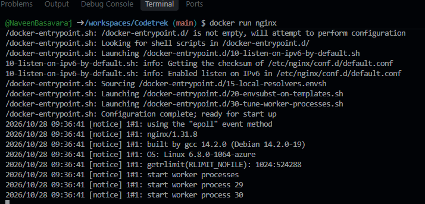
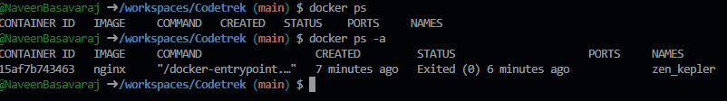
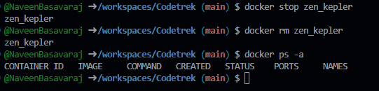
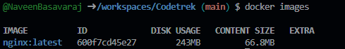
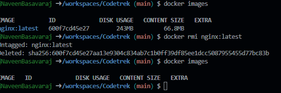

# Basic Docker Commands

## 1. Start a container

```docker run``` is used to run a container from an image.
Note that we need an image locally or from docker registry or a private registry.

```linux
docker run nginx
```
- The above command will run an instance of NGINX application on docker host if it already exists.
- If the image is not present on docker host, it will go to docker hub registry and pull that image down.
- Note that this is done only first time, for subsequent executions the same image will be reused.




> Docker Hub Registry has rate limits.
>
> Unauthenticated or Anonymous - 100 pulls/6hrs
>
> Free After Login - 200 pulls / 6hrs
>
> Paid - unlimited

## 2. List Running Containers

```
docker ps
```

- Lists all running containers
- Provides container_id, image used, ports being used and random id(names)

## 3. List All Containers

```
docker ps -a
```
- Lists all containers - Running and Stopped.



## 4. Stopping A Container

```
docker stop <container_name>
```
- ```docker stop`` needs container name

## 5. Remove container permanently
```
docker rm <container_name>
docker rm <container_id1> <container_id2> <container_id3> ...
```


## 6. List local images

```
docker images
```


## 7. Remove an image from docker host

```
docker rmi image
```


- No containers should be using the image (else it cannot be deleted)
- Use ```docker stop container_name`` to stop the container first and then remove the image

## 8. Container's Life
- Containers need a process to be running for it to stay alive
- Once the process ends container immediately stops and exits
> One process - that's the container life
>
> Container only lives as long as the proccess inside it is alive
>
> if the process crashes or dies, the container exits

```
docker run ubuntu
docker run ubuntu sleep 5
```

- Containers are not meant to host operating systems. Ubuntu container above immediately exits.
- the sleep command keeps ubuntu container alive for 5 seconds

## 9. Running commands inside docker container

- can use ```docker exec`` command to run commands inside container
```
docker exec <container_id> cat /etc/hosts
```

## 10.  Attach and Re-Attach

- To run a container in the background use ```-d``` flag

```
docker run -d nginx
```
- To run a detached container in the foreground use ```-attach``` command
```
docker attach <container_id>
```

> While specifying the <container_id>, we can use only first 5 characters
>
> Ex: if container id is a043d40f85fe, specify only ```a043d```
>
> ```docker attach a043d```

## 11. System Prune

```
docker system prune
```
Removes 
- all containers
- all networks not used by at least one container
- all dangling images
- ununsed build cache